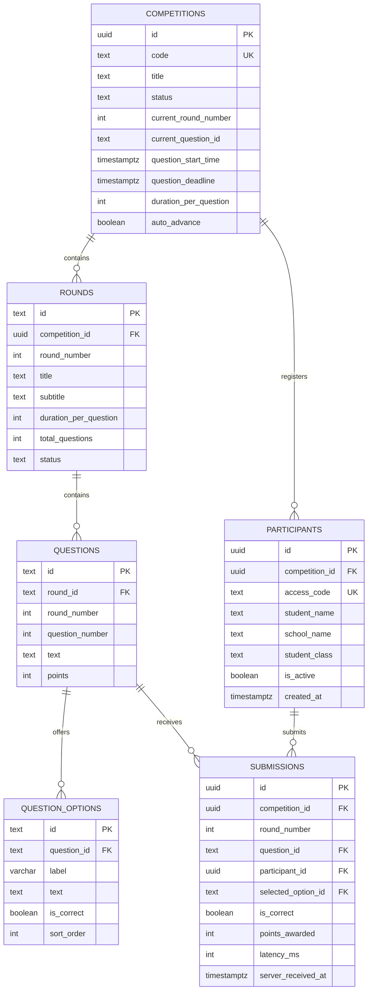

# Quizmania Database Architecture & Schema Specification

## 1. Schema Entity-Relationship Diagram

---

## 2. Table Definitions & Constraints

### `competitions`
Maintains competition status and official question timing.
- `status`: `'upcoming' | 'registration_open' | 'registration_closed' | 'in_progress' | 'completed' | 'results_published'`
- `duration_per_question`: Default `20` seconds.

### `rounds`
- `round-1`: General Paper (10 questions, 20s each).
- `round-2`: Subject Paper (Python, 10 questions, 20s each).

### `questions` & `question_options`
- Stores questions and 4 options (A, B, C, D) per question.
- `is_correct`: Stored server-side. Not accessible by students via public views.

### `participants`
- Natural identity constraint: `UNIQUE (competition_id, student_name, school_name, student_class)`
- Prevents duplicate registration while allowing seamless session re-entry.

### `submissions`
- Idempotency constraint: `UNIQUE (question_id, participant_id)`
- Prevents double submissions or score manipulation.

---

## 3. Authoritative Stored Procedures (RPCs)

### `register_participant(p_competition_code, p_student_name, p_school_name, p_student_class)`
- Validates names and ensures class is either `11th` or `12th`.
- Verifies registration is currently open.
- Returns participant ID and unique access code (`QZ-XXXXXX`).

### `submit_student_answer(p_participant_id, p_question_id, p_selected_option_id)`
- Verifies competition is `in_progress`.
- Checks `clock_timestamp() <= question_deadline + interval '500 milliseconds'`.
- Evaluates `is_correct` on the server and awards points (10 or 0).
- Records `latency_ms` for tie-breaking.

### `get_leaderboard(p_competition_id)`
- Aggregates Round 1, Round 2, and Total Scores.
- Calculates dense rank with deterministic tie-breaking.
